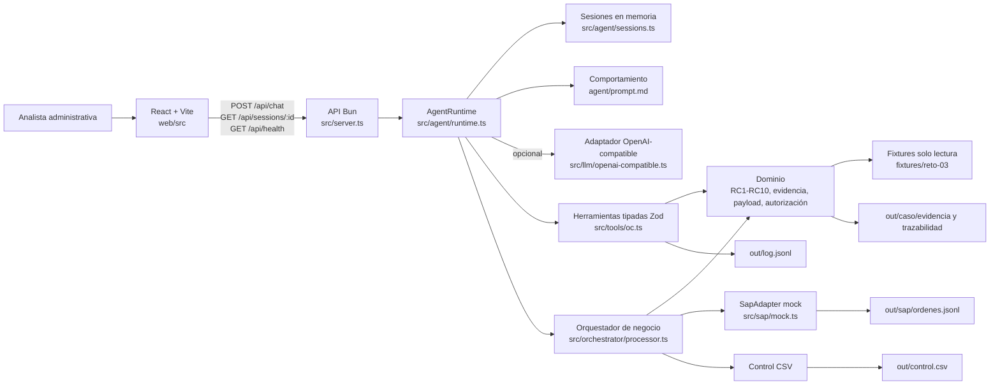

# SOLUCIÓN — Agente conversacional de órdenes de compra SAP

## 1. Problema

La analista administrativa pierde tiempo y asume riesgo de control al transcribir manualmente solicitudes, cotizaciones y aprobaciones a SAP, mientras auditoría y dirección no pueden medir de forma confiable las órdenes de compra retroactivas.

## 2. Arquitectura

El MVP es una aplicación local Full Stack. La interfaz React consume una API HTTP en Bun/TypeScript; la API ejecuta un runtime conversacional, valida herramientas con Zod, aplica las reglas RC1–RC10 de forma determinista y registra la creación en un adaptador SAP simulado con persistencia en archivos.



| Pieza | Ubicación | Responsabilidad |
|---|---|---|
| Frontend | `web/` | Chat, historial, estados de carga/error, herramientas ejecutadas, vista previa de OC, bloqueos, confirmaciones y número de OC. |
| API y servidor | `src/server.ts` | `POST /api/chat`, `GET /api/sessions/:id` y `GET /api/health`. |
| Runtime | `src/agent/` | Sesiones, contexto, confirmaciones, ciclo LLM, límites y modo local determinista. |
| Comportamiento | `agent/prompt.md` | Instrucciones del agente, separadas del código. |
| Conocimiento | `src/knowledge/ordenes-compra.md` | Contexto del proceso que no ejecuta controles. |
| Ejecución | `src/tools/oc.ts` y `src/domain/` | Herramientas P0, normalización, RC1–RC10, evidencia, payload y autorización. |
| SAP simulado | `src/sap/mock.ts` | Implementación de `SapAdapter` con secuencia desde `4500000001`. |
| Persistencia | `out/` | `ordenes.jsonl`, `control.csv`, `log.jsonl`, evidencias, trazabilidad y autorizaciones. |

La separación evaluada por el PRD se mantiene: el comportamiento está en `agent/prompt.md`, el conocimiento en `src/knowledge/` y la ejecución en `src/tools/` y el dominio. Un cambio en una regla de negocio no requiere tocar el servidor HTTP.

## 3. Ciclo del agente

### Modo local determinista

Sin `LLM_BASE_URL`, `LLM_MODEL` y `LLM_API_KEY`, la aplicación opera en modo local determinista. No es inteligencia artificial generativa: identifica el caso, ejecuta las herramientas reales de lectura y validación, delega la decisión al orquestador y produce respuestas basadas en los resultados reales del backend. La interfaz lo informa como **modo local determinista (sin LLM)**.

### Modo LLM

Con configuración, el runtime ejecuta:

1. La analista envía un mensaje.
2. El modelo recibe el prompt, el historial y las herramientas permitidas.
3. Si responde con `tool_calls`, el backend conserva ese mensaje del asistente, valida cada argumento con Zod y ejecuta solo herramientas autorizadas.
4. Cada resultado se envía como `role: tool` con el `tool_call_id` correspondiente.
5. El modelo continúa hasta responder sin herramientas o hasta el límite `MAX_TOOL_ITERATIONS`, cuyo valor predeterminado es 25.

El protocolo se probó con un proveedor HTTP local simulado. La conexión con un proveedor real no se ha verificado.

### Confirmación humana y sesiones

Las confirmaciones están ligadas a sesión, caso y códigos RC. El silencio mantiene el estado pendiente; un rechazo explícito impide crear la OC; una confirmación parcial no autoriza la creación; una confirmación de otro caso o de otra sesión no se reutiliza.

El frontend persiste el identificador en `sessionStorage`, de modo que la sesión sobrevive a recargas y HMR dentro de la misma pestaña, pero no se comparte entre pestañas. Las sesiones del backend residen en memoria y se pierden si el servidor se reinicia.

### Autorización de creación

El LLM no recibe acceso directo a `oc_crear`, a la generación de evidencia, a la construcción del payload ni a la escritura de autorizaciones. En modo LLM solo puede pedir lectura, validación o `oc_procesar_caso`; esta última delega al orquestador del backend.

Antes de crear una OC, el orquestador vuelve a validar, genera la evidencia, construye el payload y emite una autorización ligada a:

- caso y `solicitud_id`;
- sesión;
- SHA-256 de la validación;
- SHA-256 del payload;
- códigos de confirmación aceptados.

`oc_crear` recalcula la validación y rechaza cualquier payload alterado, sesión distinta, bloqueo o confirmación incompleta.

## 4. Elección del modelo

| Elemento | Decisión |
|---|---|
| Proveedor previsto | Google Gemini |
| Modelo propuesto | `gemini-2.5-flash` |
| Integración | `OpenAiCompatibleAdapter` mediante `LLM_BASE_URL`, `LLM_MODEL` y `LLM_API_KEY` |
| Estado | Implementado y probado con proveedor HTTP simulado; **conexión real pendiente de verificación**. |

Se elige Gemini 2.5 Flash por ser un modelo de propósito general con tool calling y una tarifa por token adecuada para un MVP de operaciones repetitivas. El sistema no depende del modelo para aplicar reglas: si el modelo falla, el backend conserva los controles deterministas.

### Costo estimado por caso

Fuente oficial: [Gemini API — Pricing](https://ai.google.dev/gemini-api/docs/pricing).

Las tarifas de **USD 0,30 por millón de tokens de entrada de texto** y **USD 2,50 por millón de tokens de salida, incluidos tokens de razonamiento**, corresponden al **nivel pagado (Paid Tier) estándar de Gemini 2.5 Flash** (`gemini-2.5-flash`). Las tarifas pueden cambiar; deben reconfirmarse en la fuente antes de presupuestar.

El proyecto utilizará inicialmente el **nivel gratuito (Free Tier)**, sin costo por token, dentro de sus cuotas y límites de uso. En ese nivel, según la misma fuente, los datos pueden usarse para mejorar los productos de Google, por lo que no debe enviarse información sensible o real. La fórmula siguiente aplica solo si se migra al nivel pagado.

Fórmula:

```text
costo_USD = (tokens_entrada / 1.000.000 × 0,30) + (tokens_salida / 1.000.000 × 2,50)
```

Supuesto ilustrativo, no medido: 6.000 tokens de entrada y 800 de salida por caso.

```text
(6.000 / 1.000.000 × 0,30) + (800 / 1.000.000 × 2,50) = USD 0,0038
```

Este valor no es una medición real; debe recalcularse con `usage.total_tokens` y, preferiblemente, separando entrada y salida cuando se conecte el proveedor real.

## 5. Matriz de controles

| Regla | Implementación | Prueba principal |
|---|---|---|
| RC1 | Busca proveedor por NIT normalizado o, si falta NIT, por nombre normalizado; exige proveedor activo. | `sol-002`, `sol-006` y proveedor inactivo en `tests/rules.test.ts`. |
| RC2 | Exige aprobación con “Aprobado” y remitente autorizado para el centro de costo. | `sol-003` y aprobación ausente en `tests/rules.test.ts`. |
| RC3 | Compara el valor total con el tope del aprobador del centro. | Caso derivado que supera el tope. |
| RC4 | Verifica que la subárea pertenezca al centro de costo. | Caso derivado con subárea ajena. |
| RC5 | Pide confirmación si la diferencia entre cotización y solicitud supera el 2 % o si falta cotización. | `sol-004` y cotización ausente. |
| RC6 | Deriva IVA del proveedor y exige confirmación. | `sol-006`. |
| RC7 | Deriva condición de pago del proveedor sin confirmación adicional. | `sol-006`. |
| RC8 | Marca retroactividad si la factura antecede la solicitud y exige confirmación. | `sol-005`, unitario y E2E. |
| RC9 | Pide confirmación si la aprobación es anterior a la solicitud. | Caso derivado con aprobación anticipada. |
| RC10 | Bloquea si cantidad × valor unitario difiere del total en más de una unidad monetaria. | Caso derivado con descuadre. |

La regla técnicamente más compleja fue **RC8**, por la interacción entre detección de factura, normalización de fechas, confirmación humana, conservación de `retroactiva=true` en todas las transiciones de control y creación posterior autorizada. Su evidencia E2E final contiene dos registros de `SOL-2026-005`: pendiente y exitoso, ambos con `retroactiva=true`; el exitoso corresponde a la OC `4500000002`.

## 6. Diseño del adaptador SAP real

### Opción recomendada

La opción preferente es **OData `API_PURCHASEORDER_PROCESS_SRV`**, mediante una capa de integración del backend. Es la opción más cercana al contrato de API del payload y facilita trazabilidad HTTP, controles de seguridad y pruebas contractuales. `BAPI_PO_CREATE1` mediante RFC queda como alternativa cuando no exista exposición OData; SAP Integration Suite es recomendable si la organización ya centraliza integraciones allí.

Como la viabilidad de SAP no está confirmada, la implementación real debe comenzar con una prueba técnica en un entorno no productivo y un contrato aprobado por el equipo SAP.

### Mapeo propuesto

| Payload MVP | SAP real propuesto |
|---|---|
| `referencia.solicitud_id` | Referencia externa o texto de cabecera para idempotencia |
| `sociedad` | Sociedad |
| `organizacion_compras` | Organización de compras |
| `proveedor.codigo_sap` | Proveedor |
| `moneda` | Moneda del documento |
| `condiciones_pago` | Condición de pago |
| `posiciones[].numero` | Posición de pedido |
| `posiciones[].descripcion` | Texto breve |
| `posiciones[].cantidad` | Cantidad |
| `posiciones[].unidad` | Unidad de medida |
| `posiciones[].precio_unitario` | Precio neto |
| `posiciones[].centro_costo` | Imputación a centro de costo |
| `posiciones[].subarea` | Atributo o texto de imputación definido por negocio |
| `posiciones[].indicador_iva` | Indicador de impuesto |
| `aprobador.evidencia_sha256` | Texto, adjunto o referencia documental de evidencia |
| `excepciones` | Texto de cabecera o registro complementario de auditoría |

El mapeo exacto requiere validación con el equipo SAP porque depende de la configuración del cliente.

### Autenticación y credenciales

Las credenciales deben residir solo en un gestor de secretos del entorno backend, como un vault corporativo o el servicio de secretos de la nube elegida. Nunca deben aparecer en el prompt, el frontend, el repositorio, `log.jsonl` ni respuestas de API. El adaptador debe usar una identidad técnica con permisos mínimos y, si SAP lo permite, OAuth o certificados en lugar de usuario y contraseña.

### Idempotencia y errores parciales

Antes de crear, el adaptador consultaría SAP por `solicitud_id`. Si existe una OC, devuelve su número. La solicitud de creación debe incluir una clave estable derivada de `solicitud_id`.

Si SAP agota el tiempo de espera o responde con resultado incierto, el sistema no debe reintentar ciegamente: consulta por referencia, registra el estado como pendiente de reconciliación y solo crea si confirma que no existe documento.

### Plan B

Si SAP no está disponible o la integración no es viable, el agente puede seguir ahorrando tiempo mediante:

- una vista de OC lista para copiar en SAP GUI;
- un archivo CSV o plantilla de carga masiva aprobada por SAP;
- conservación de evidencia SHA-256, trazabilidad y control;
- un estado “preparada para SAP” sin afirmar que la OC fue creada.

**Estado actual:** SAP real no está implementado ni conectado; solo existe `MockSapAdapter`.

## 7. Lectura del proceso

Las órdenes de compra retroactivas indican que la compra se formaliza después de que el proveedor ya emitió la factura. En `sol-005`, la factura del 10 de agosto de 2026 es anterior a la solicitud del 27 de agosto de 2026. Esto debilita el control previo del gasto: la aprobación y la orden dejan de autorizar la compra antes de que ocurra y pasan a regularizar una obligación existente.

El riesgo no es solo administrativo. Una OC retroactiva puede ocultar compras no planeadas, reducir la capacidad de comparar cotizaciones, dificultar la negociación y generar presión para aprobar pagos sin la evaluación normal. También dificulta medir si el problema se concentra en ciertos proveedores, centros de costo o aprobadores.

La recomendación para dirección es no bloquearlas automáticamente mientras no exista una política formal, pero sí medirlas y gestionarlas como excepción. El MVP ya registra `retroactiva=true` en `out/control.csv`. Con ese dato se pueden construir indicadores mensuales por proveedor, centro de costo y aprobador.

La mejora de proceso propuesta es establecer una política explícita para compras posteriores a factura: justificación obligatoria, aprobación de un nivel superior cuando aplique y revisión periódica de casos repetidos. A mediano plazo, conviene exigir que la solicitud y la cotización se registren antes de aceptar facturas de proveedores.

## 8. Decisiones y trade-offs

| Decisión | Alternativa descartada | Justificación |
|---|---|---|
| Controles RC1–RC10 deterministas en backend | Dejar que el LLM decida si una OC es válida | Los controles financieros deben ser repetibles, auditables y probables; el LLM solo conversa y solicita acciones. |
| Autorización persistida con SHA-256 | Confiar en `confirmado: true` enviado por el modelo | Evita que el modelo cree una autorización o altere un payload después de la validación. |
| Ocultar `oc_crear` al LLM y exponer `oc_procesar_caso` | Exponer todas las herramientas P0 al modelo | Reduce el riesgo de saltarse la secuencia validación–evidencia–payload–autorización–creación. |
| Modo local determinista | Exigir proveedor LLM para cualquier demostración | Permite verificar el flujo y la UI sin credenciales ni costos, declarando que no es IA generativa. |
| Sesión por pestaña con `sessionStorage` | `localStorage` compartido | Mantiene contexto ante recarga y HMR sin mezclar confirmaciones entre pestañas. |
| Persistencia en archivos | Base de datos | El PRD no exige base de datos; los archivos facilitan auditoría y demo reproducible. |

## 9. Supuestos

- Los fixtures representan versiones normalizadas de Excel, PDF y correos; no se leen binarios reales.
- Los maestros de los fixtures son completos para el reto.
- La solicitud es la fuente del monto autorizado; una diferencia con la cotización requiere confirmación, no modifica el monto.
- El correo de aprobación es evidencia suficiente para el MVP.
- El NIT se normaliza quitando separadores; si tiene más de nueve dígitos, el último se trata como dígito de verificación.
- Las fechas de negocio se comparan por `YYYY-MM-DD`.
- La identidad de quien confirma se representa con el identificador de sesión porque autenticación está fuera de alcance.
- Las unidades `UN`, `H` y `MES` se infieren de la descripción mediante una regla determinista.
- Para producción falta confirmar política de retroactividad, mapeo SAP real, mecanismo de autenticación, persistencia, retención de evidencias y proveedor LLM aprobado.

## 10. Cobertura

| Historia | Criterio | Prioridad | Estado | Evidencia o pendiente |
|---|---|---|---|---|
| HU-1 | Paquete normalizado | P0 | Hecho | `oc_leer_paquete`, pruebas de lectura y E2E. |
| HU-1 | Adjunto ausente como `null` y nombre de faltante | P0 | Hecho | Prueba de cotización ausente. |
| HU-2 | RC1–RC10 con bloqueos, confirmaciones, derivados y retroactividad | P0 | Hecho | Pruebas unitarias, demo y E2E. |
| HU-2 | Confirmaciones solo con decisión explícita | P0 | Hecho | Pruebas API, LLM simulado y Playwright. |
| HU-3 | Payload validado con Zod | P0 | Hecho | Esquemas, pruebas de payload y vista previa. |
| HU-3 | Trazabilidad por campo | P0 | Hecho | `out/<caso>/trazabilidad.json`. |
| HU-4 | Evidencia TXT con encabezados, cuerpo y SHA-256 | P0 | Hecho | `aprobacion.txt` y pruebas de evidencia. |
| HU-4 | Evidencia PDF | P1 | No hecho | Pendiente. |
| HU-5 | Creación solo apta y confirmada | P0 | Hecho | Autorización SHA-256 y pruebas negativas. |
| HU-5 | Secuencia desde `4500000001` | P0 | Hecho | Demo, pruebas y E2E. |
| HU-5 | Idempotencia por `solicitud_id` | P0 | Hecho | `sol-001` repetido y pruebas. |
| HU-5 | Registro de control por intento | P0 | Hecho | `out/control.csv` con encabezado oficial. |
| HU-6 | Errores legibles y sesión continua | P0 | Hecho | Pruebas de JSON inválido, timeout simulado y error visual de `sol-999`. |
| Arquitectura | Proveedor LLM real | P0 del reto | Parcial | Adaptador implementado; conexión real no verificada. |
| Entrega | Link público | Requisito de entrega | No hecho | No hay despliegue. |
| Bonus | Carpeta `modulo/` | Bonus | No hecho | No implementado. |
| Opcional | `oc_leer_excel` | P1 | No hecho | No implementado. |

Para producción faltan proveedor LLM verificado, autenticación, sesiones persistentes, observabilidad productiva, SAP real, gestión de secretos, despliegue, PDF y procedimientos operativos.

## 11. Uso de inteligencia artificial

Se usaron dos asistentes con funciones diferenciadas.

### ChatGPT — análisis y dirección del trabajo

Se usó **ChatGPT** como apoyo de la desarrolladora, fuera del repositorio, para:

- analizar el PRD e identificar requisitos, entregables y criterios de evaluación;
- elaborar las instrucciones por fase que se entregaron a PERXIA;
- revisar los entregables y reportes generados por PERXIA y detectar vacíos, inconsistencias o afirmaciones que requerían verificación.

ChatGPT no escribió ni ejecutó código del proyecto, no ejecutó pruebas ni validaciones y no tuvo acceso directo al repositorio.

### PERXIA — implementación y ejecución

**PERXIA** fue el agente encargado de implementar y ejecutar el trabajo técnico:

- analizar el PRD, los fixtures y el estado del repositorio;
- redactar la documentación funcional y técnica `docs/01` a `docs/15` y este documento;
- implementar backend, herramientas, controles, adaptador SAP simulado, runtime conversacional, adaptador LLM y frontend React;
- crear pruebas unitarias, de integración, HTTP simulado y Playwright;
- ejecutar verificaciones y documentar evidencia;
- consultar documentación técnica de Zod, Bun, Vite, ESLint, typescript-eslint y Gemini API.

Dentro de PERXIA también se usó un subagente de exploración para extraer el contrato del PRD, los documentos y los fixtures. No se registró uso de Claude, Copilot, Cursor u otros asistentes en este trabajo.

### Propuestas descartadas o corregidas

- Usar `confirmado: true` como autorización: descartado por inseguro.
- Exponer `oc_crear` directamente al LLM: descartado para impedir saltarse controles.
- Presentar el modo local como IA generativa: descartado; se identifica como determinista.
- Usar `localStorage` para la sesión: descartado tras detectar que compartía estado entre pestañas.
- Validar responsive contra el ancho completo del viewport: corregido para medir el espacio útil y evitar confundir padding con defecto.
- Afirmar un proveedor LLM real como verificado: descartado por falta de credenciales.

## 12. Riesgos

| Riesgo | Impacto | Mitigación |
|---|---|---|
| Exposición de credenciales | Uso indebido del proveedor LLM o SAP | Gestor de secretos, variables solo en backend, rotación, auditoría y escaneo de secretos en CI. |
| Ausencia de autenticación | Cualquier usuario con acceso podría operar el agente | SSO, autorización por rol y vinculación de confirmaciones a identidad real. |
| Sesiones en memoria | Pérdida de contexto al reiniciar | Persistencia durable con expiración, cifrado y control de concurrencia. |
| Comportamiento del modelo LLM | Respuestas incorrectas, latencia o errores del proveedor | Controles deterministas, límites, timeout, validación Zod y prueba real con observabilidad. |
| SAP real no implementado | Integración inviable o errores de mapeo | Prueba técnica, contrato con SAP, ambiente no productivo, idempotencia y Plan B. |
| Trazabilidad incompleta | Dificultad para auditoría | Conservar control, evidencia, autorización y logs con retención definida. |
| Errores parciales de integración | Duplicados o estados inciertos | Consulta por referencia, reconciliación y bloqueo de reintentos ciegos. |
| Datos sensibles en logs | Exposición de información de proveedores o aprobaciones | Minimización y enmascaramiento de logs; políticas de retención y acceso. |
| Despliegue público sin hardening | Abuso de API o costos LLM | Rate limiting, límites de tokens, autenticación y monitoreo de consumo. |

## Estado de entrega

El MVP está validado localmente en modo determinista y en modo LLM contra un proveedor HTTP simulado. No existe conexión verificada con un proveedor LLM real, no hay despliegue público, no hay carpeta `modulo/` y SAP real no está conectado. Por tanto, el estado no es productivo.
