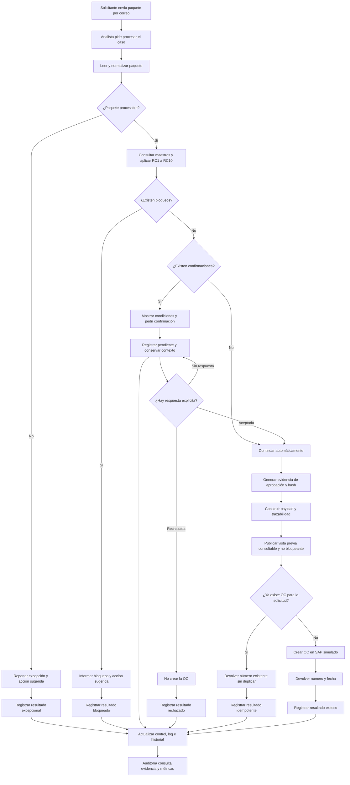

# 03. Flujo del proceso

## A. Resumen

El agente recibe un caso de compra, normaliza y valida el paquete contra los maestros y RC1–RC10. Los casos aptos continúan automáticamente hasta SAP simulado; solo las condiciones de confirmación del PRD detienen el flujo, mientras bloqueos, pendientes, rechazos, éxitos e intentos idempotentes quedan registrados.

## B. Tabla de pasos

| Paso | Actor / Rol | Entrada | Salida esperada |
|---|---|---|---|
| 1. Enviar paquete | Solicitante | Solicitud, cotización, aprobación y factura opcional | Correo recibido con adjuntos declarados |
| 2. Solicitar procesamiento | Analista administrativa | Identificador del caso en el chat | Solicitud de procesamiento asociada a una sesión |
| 3. Leer y normalizar paquete | Agente / `oc_leer_paquete` | Carpeta del caso y archivos normalizados | Paquete con correo, solicitud, cotización, aprobación y factura opcional; faltantes como `null` |
| 4. Evaluar legibilidad y completitud técnica | Agente / herramientas | Paquete leído | Paquete procesable o excepción legible con acción sugerida |
| 5. Consultar maestros y aplicar RC1–RC10 | `oc_validar` | Paquete, proveedor, centro, subárea, aprobador, IVA y pago | `apta`, `bloqueos`, `confirmaciones`, `derivados`, `retroactiva` |
| 6. Resolver bloqueos | Agente | Uno o más incumplimientos de tipo bloqueo | Caso no creado, razón y acción sugerida; resultado bloqueado registrado |
| 7. Presentar confirmaciones | Agente | Condiciones RC5, RC6, RC8 o RC9 | Pregunta explícita, contexto conservado y resultado pendiente registrado |
| 8. Mantener confirmación pendiente | Agente / sesión | Pregunta sin respuesta explícita | Caso pendiente; no se crea OC y el silencio no se interpreta como aceptación ni rechazo |
| 9. Aceptar confirmación | Analista administrativa | Respuesta afirmativa explícita | Confirmación aceptada; autorización para continuar el proceso |
| 10. Rechazar confirmación | Analista administrativa | Respuesta negativa explícita | Caso no creado y resultado rechazado registrado |
| 11. Continuar flujo apto | Agente | Validación sin confirmaciones, o confirmaciones aceptadas | Procesamiento automático sin aprobación manual adicional |
| 12. Generar evidencia | `oc_generar_evidencia` | Aprobación del caso | `aprobacion.txt` P0 o PDF P1 y SHA-256 |
| 13. Construir payload y trazabilidad | `oc_construir_payload` | Paquete validado, derivados y hash de evidencia | `OrdenCompra` válida, `trazabilidad.json` y vista previa disponible para consulta |
| 14. Publicar vista previa no bloqueante | Agente | Payload construido | Resumen visible; el flujo normal no espera una nueva aprobación |
| 15. Verificar idempotencia | Adaptador SAP simulado | `solicitud_id` | OC existente o autorización para crear una nueva |
| 16. Resolver intento idempotente | Adaptador SAP simulado / agente | OC existente para la referencia | Número existente devuelto, sin duplicado; resultado idempotente registrado |
| 17. Crear OC | `oc_crear` / SAP simulado | Payload válido y, cuando aplica, confirmación aceptada | Número secuencial y fecha de la nueva OC |
| 18. Registrar creación exitosa | Backend / orquestador | Resultado de SAP simulado | Resultado exitoso registrado y comunicado |
| 19. Consumir control | Contabilidad / Auditoría | Evidencia, trazabilidad y `control.csv` | Seguimiento de resultados, controles y retroactividad |

## C. Diagrama

## D. Correspondencia entre tabla y diagrama

- La ruta **apta sin confirmaciones** continúa automáticamente; la vista previa queda disponible, pero no es una compuerta de aprobación. Así, `sol-001` puede terminar con OC creada sin intervención humana adicional.
- La ruta **pendiente de confirmación** registra el estado y conserva el contexto. Mientras no haya respuesta explícita, no crea la OC ni cambia a aceptada o rechazada.
- La ruta **confirmación aceptada** se une al flujo apto y continúa con evidencia, payload e idempotencia.
- La ruta **confirmación rechazada** no crea la OC y registra un resultado distinto del pendiente.
- La ruta **bloqueada** corresponde a incumplimientos de RC1, RC2, RC3, RC4 o RC10; una confirmación no levanta esos bloqueos.
- La ruta **excepcional** corresponde a un paquete o herramienta no procesable y no se confunde con un bloqueo de negocio.
- Las rutas **exitosa** e **idempotente** devuelven un número de OC, pero solo la primera crea un registro nuevo en SAP simulado.

## E. Registro de control: requisito y decisión propuesta

### Requisito oficial del PRD

HU-5 exige que cada intento exitoso, bloqueado o pendiente agregue una fila a `out/control.csv` con `solicitud_id, resultado, numero_oc, retroactiva, bloqueos, confirmaciones, ts`. También exige idempotencia: repetir un `solicitud_id` devuelve el número existente y no crea otra OC.

### Decisión de diseño propuesta para implementación

Se propone que el **backend/orquestador del ciclo del agente** sea el único responsable de anexar transiciones a `control.csv`, porque observa todos los desenlaces, incluso aquellos en los que `oc_crear` no se invoca. Las herramientas devuelven resultados tipados; el orquestador registra el estado sin delegar esta responsabilidad al LLM.

| Resultado de control | Momento de registro | `numero_oc` esperado |
|---|---|---|
| `bloqueado` | Al finalizar la validación con uno o más bloqueos | Vacío |
| `pendiente_confirmacion` | Al formular la pregunta y conservar el contexto | Vacío |
| `rechazado` | Al recibir una respuesta negativa explícita | Vacío |
| `exitoso` | Al crear una OC nueva | Número nuevo |
| `idempotente` | Al encontrar una OC existente para `solicitud_id` | Número existente |

Para conservar una auditoría append-only, si un caso pasa de pendiente a rechazado o exitoso se propone registrar una fila por transición, correlacionadas por `solicitud_id` y sesión. Los valores `rechazado` e `idempotente`, la responsabilidad del orquestador y la correlación por sesión son **decisiones de diseño propuestas** para hacer verificable el requisito; no amplían ni modifican RC1–RC10.
